# Motion Engine

A Python game engine with its own Windows-XP-themed editor. A game is a
plain folder - scenes, objects, models, textures, audio and Python
scripts - and the IDE beside it edits exactly the files the runtime
loads. Write a scene as code, as blocks, or by placing things in the 3D
view; press F5 and it runs.

Import the engine as `emoeng`:

```python
import emoeng as fe


class Main(fe.Scene3D):
    uses = ("bonfire",)

    def setup(self):
        self.fire = self.spawn("bonfire", (0, 0, 0))
```

## Features

- **One window IDE** - project manager, scene view, document editor,
  code editor, visual blocks, model editor, assets browser, media
  player, build tab, docs tab and settings, all in one app
- **Documents, not prefabs** - every scene and object is a JSON
  document on disk; the script beside it says what it does
- **Real 3D** - vertex renderer on moderngl, lightmaps baked at build,
  post shaders, procedural textures, model and map (`.model3d`,
  `.map3d`) editors with UV painting
- **Blocks and code are one file** - edit as Python or snap blocks
  together; it is only ever written as Python
- **Games are folders** - copy a project anywhere; `python -m emoeng
  run <folder>` plays it
- **One-click freeze** - the Build tab drives PyInstaller with every
  switch visible, trims the bundle to what the project imports, bakes
  lights, carries the project icon and zips the result
- **Self-updating** - the bundled installer finds the newest release
  for your PC on GitHub
- **Windows and Linux releases** - native GitHub Actions runners build
  app archives with offline `docs/` and starter `projects/`, plus a
  separate standalone installer binary for each platform

## The editor

<table>
  <tr>
    <td>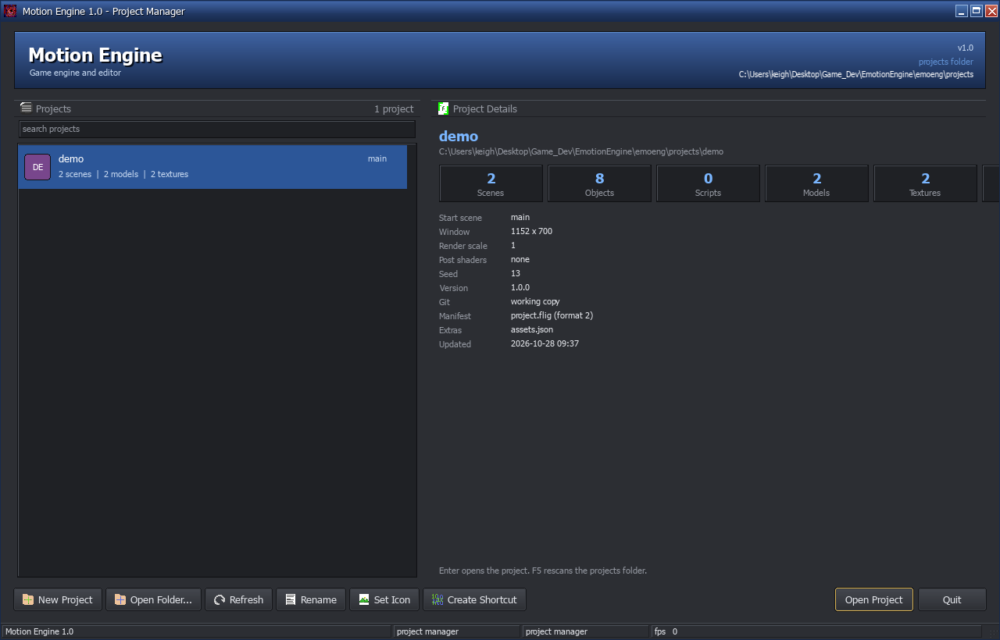</td>
    <td>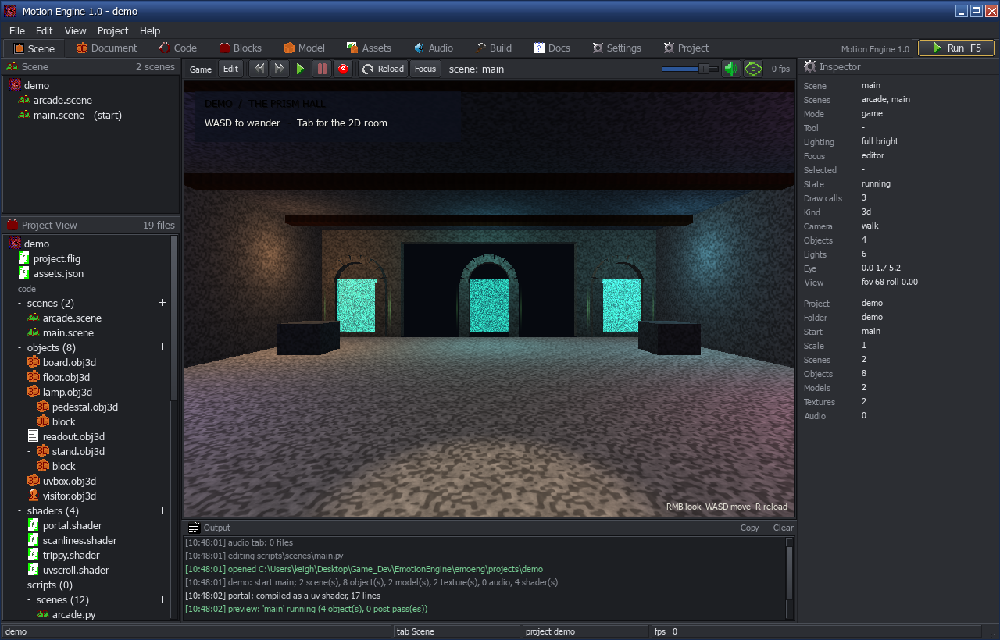</td>
  </tr>
  <tr>
    <th>Project manager - every project folder, icons and details</th>
    <th>Scene tab - the live game preview, trees and inspector</th>
  </tr>
  <tr>
    <td>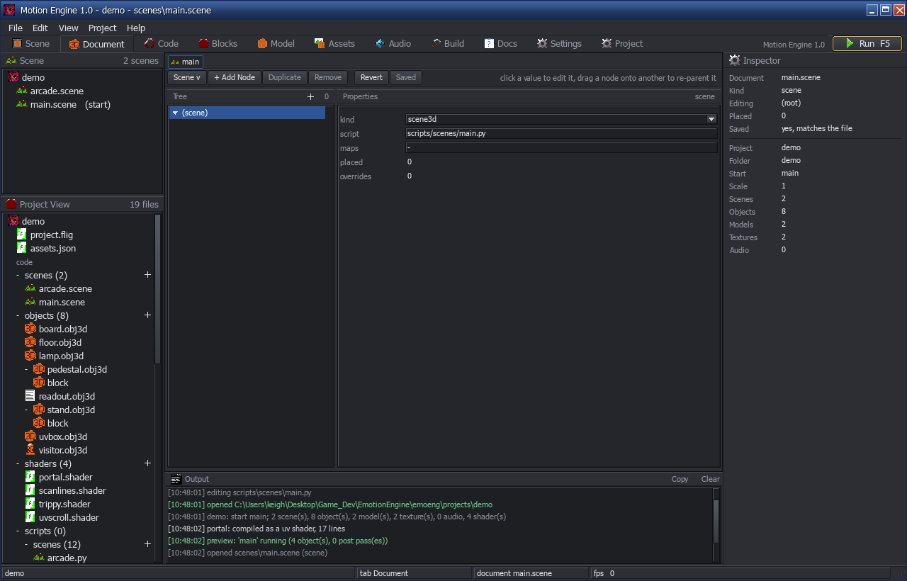</td>
    <td>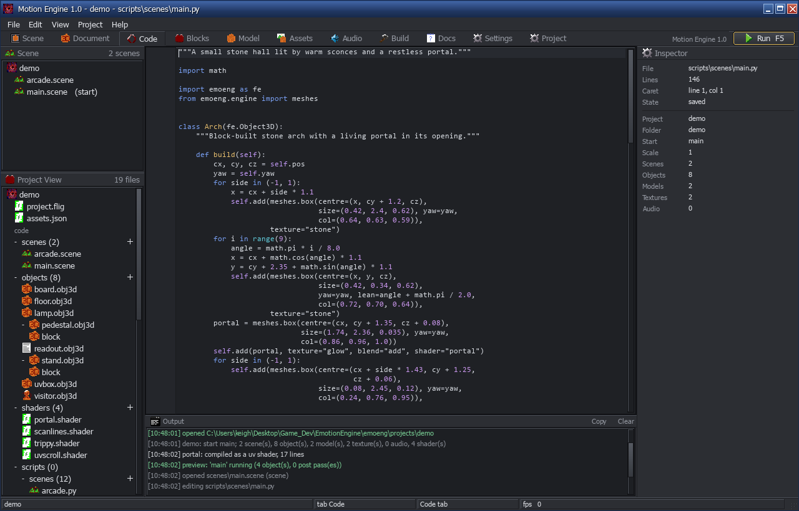</td>
  </tr>
  <tr>
    <th>Document tab - scenes and objects as editable documents</th>
    <th>Code tab - Python with syntax highlighting and a minimap</th>
  </tr>
  <tr>
    <td>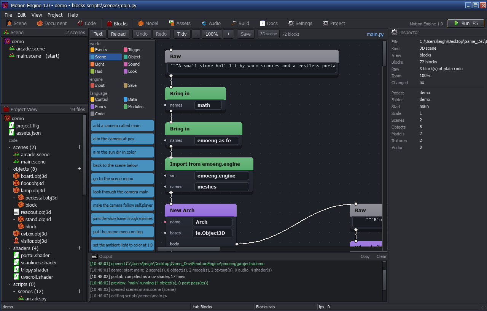</td>
    <td>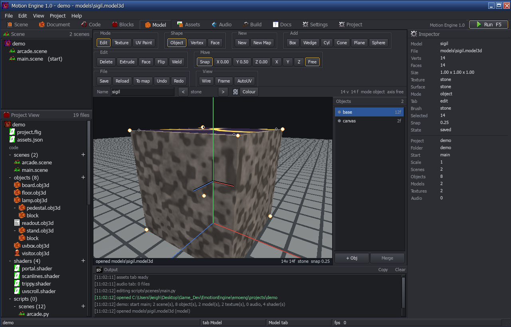</td>
  </tr>
  <tr>
    <th>Blocks tab - the same script, snapped together visually</th>
    <th>Model tab - separate objects, selection and merge controls</th>
  </tr>
  <tr>
    <td>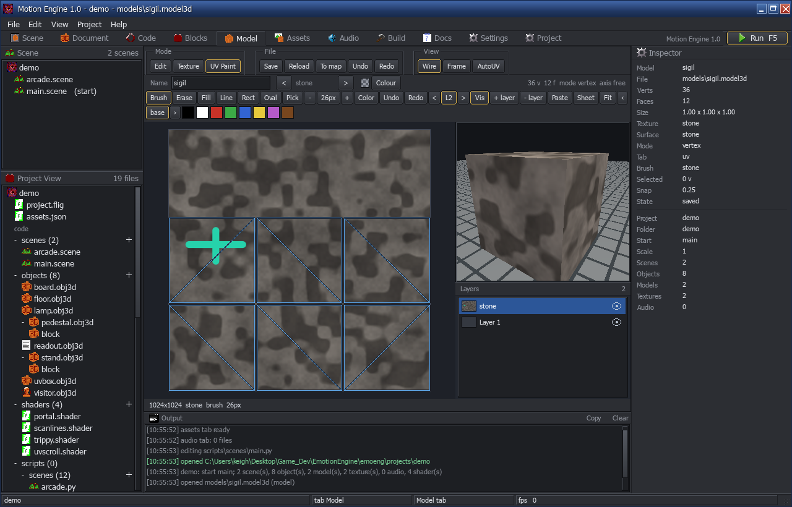</td>
    <td>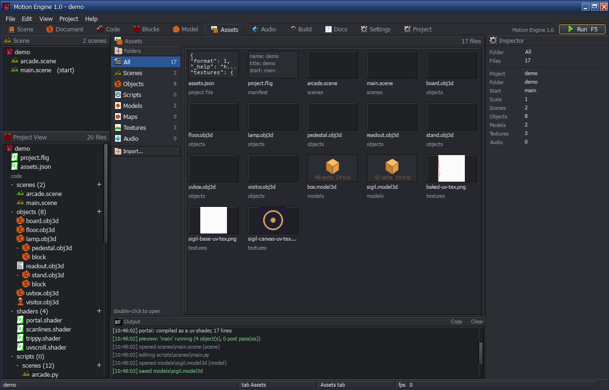</td>
  </tr>
  <tr>
    <th>UV Paint - layered painting on the atlas with a live model preview</th>
    <th>Assets tab - browse, preview and import project files</th>
  </tr>
  <tr>
    <td>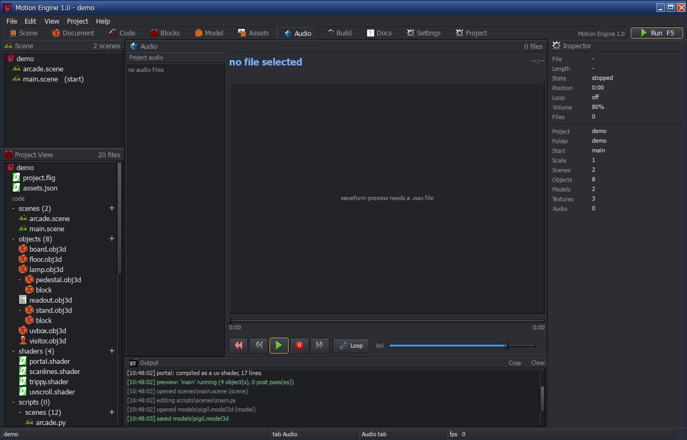</td>
    <td>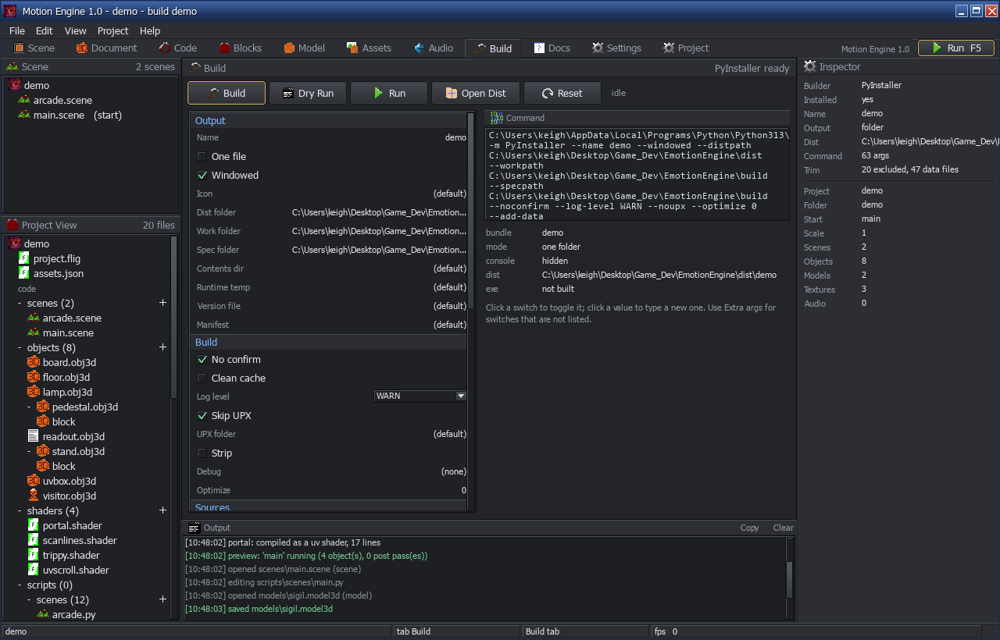</td>
  </tr>
  <tr>
    <th>Media tab - audio bank with a real media player</th>
    <th>Build tab - every PyInstaller switch, then zip it</th>
  </tr>
  <tr>
    <td>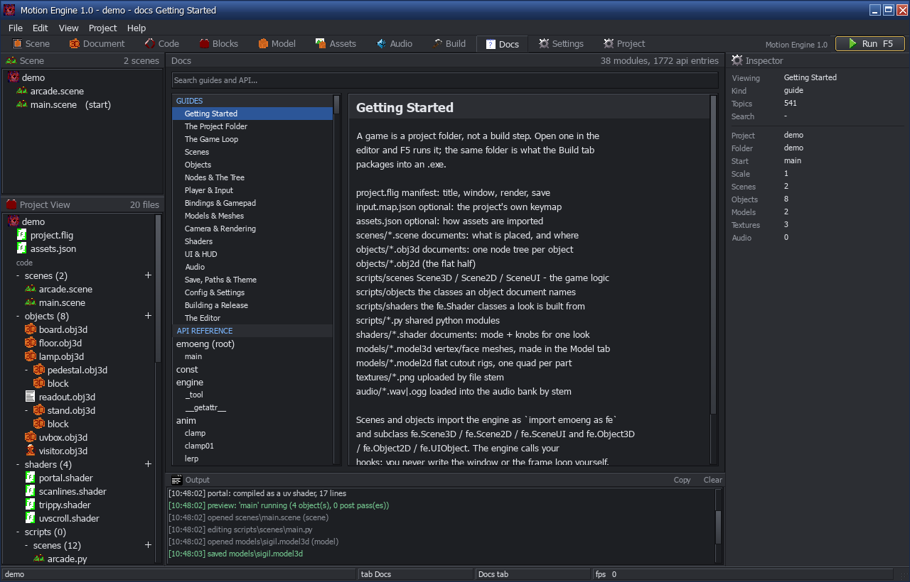</td>
    <td>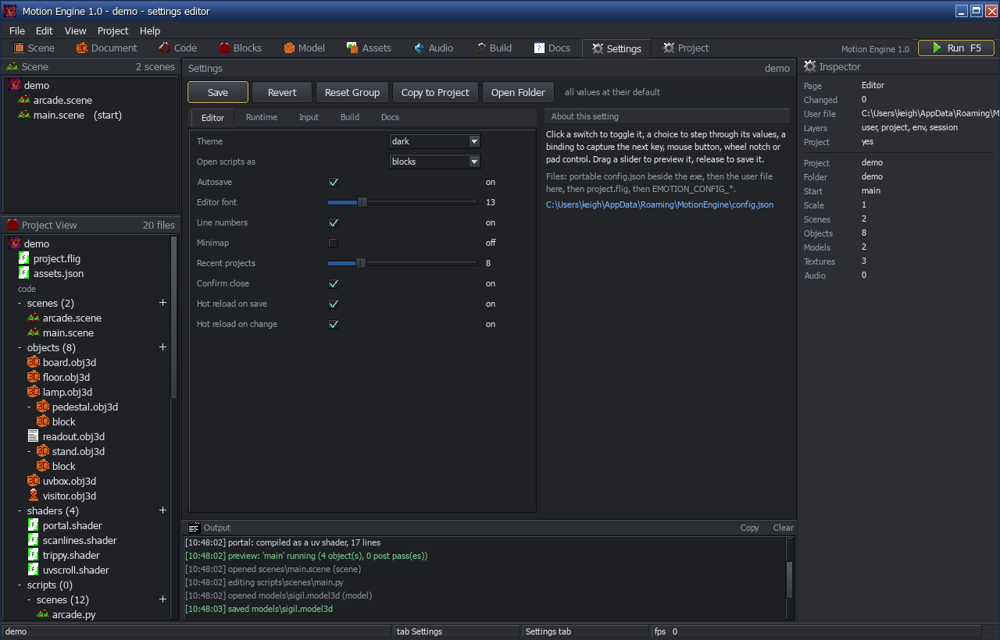</td>
  </tr>
  <tr>
    <th>Docs tab - the engine API and guides, offline</th>
    <th>Settings tab - keybinds, theme, render and runtime knobs</th>
  </tr>
</table>

## The demo

The included [demo project](emoeng/projects/demo) is a pair of small rooms:
a walkable 3D stone hall and its flat 2D companion. Both start wearing
nothing - plain stone, plain picture - and both are re-dressed by the same
nine switches: a lectern screen you click in the hall, floor plates you walk
onto in the flat room. Each switch puts a different material on one part of
the room, or a different look on a whole picture. Press **Tab** to switch
between them.

<table>
  <tr>
    <td>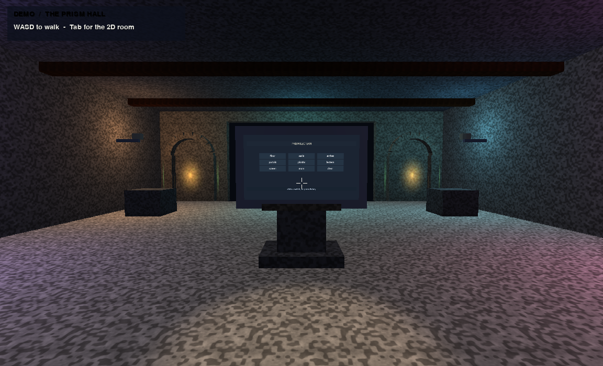</td>
    <td>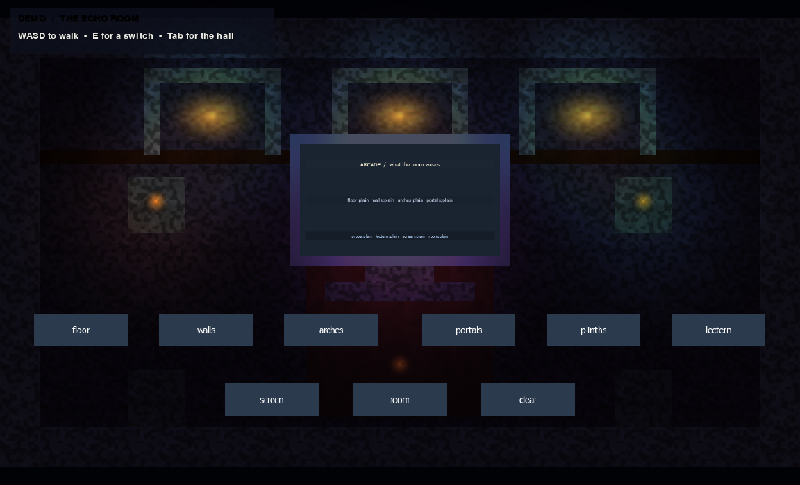</td>
  </tr>
  <tr>
    <th>Prism Hall - 3D room</th>
    <th>Echo Room - 2D room</th>
  </tr>
</table>

## Getting started

```
pip install pygame moderngl numpy pillow
git clone https://github.com/fligma/emoeng
cd emoeng
python -m emoeng                 # project manager, demo included
```

Building a standalone game needs `pip install pyinstaller` and the
Build tab (or `python -m emoeng build <project>`). Motion Engine release
archives for Windows and Linux are built by the repository's native CI jobs.
Each app archive includes its `docs/` and `projects/` folders beside the
executable; the matching installer binary is a separate release download.

<sub>Python package and import name: `emoeng`. Spoken name: Motion
Engine. See `emoeng/docs/` - or the Docs tab - for the full manual.</sub>
